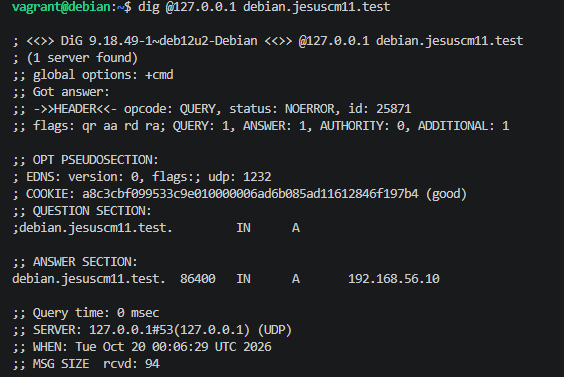

# Práctica: Configuración de un servidor DNS con BIND9
**Autor:**Jesús Caballero Martín

## 1. Objetivo

Instalar y configurar un servidor DNS utilizando BIND9 en una máquina virtual Debian gestionada con Vagrant y VirtualBox.

## 2. Configuración del servidor

- Sistema operativo: Debian 12 (Bookworm).
- Servidor DNS: BIND9.
- Nombre del dominio: jesuscm11.test.
- Dirección IP del servidor: 192.168.56.10.
- Zona directa: jesuscm11.test.
- Zona inversa: 56.168.192.in-addr.arpa.

## 3. Registros DNS configurados

- A: debian.jesuscm11.test apunta a 192.168.56.10.
- CNAME: web.jesuscm11.test es un alias de debian.jesuscm11.test.
- PTR: la dirección 192.168.56.10 resuelve a debian.jesuscm11.test.
- TXT: el dominio jesuscm11.test contiene el texto "jesuscm11".

## 4. Pruebas realizadas

### Registro A

### Registro CNAME

### Registro PTR

### Registro TXT

## 5. Resultado

Las consultas DNS se han realizado correctamente. El servidor responde con estado NOERROR y devuelve los registros configurados para las zonas directa e inversa.
