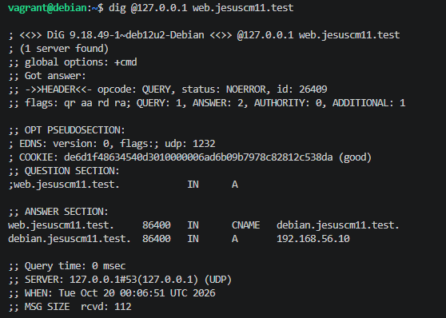
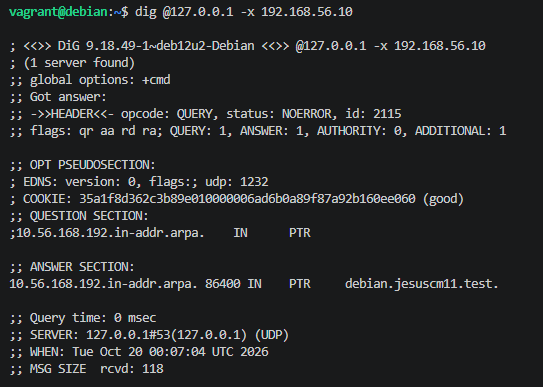
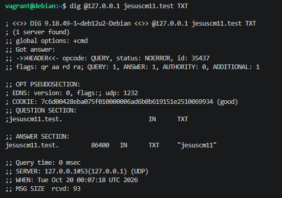

# Práctica: Configuración de un servidor DNS con BIND9

**Autor:** Jesús Caballero Martín

## 1. Objetivo

Instalar y configurar un servidor DNS con BIND9 en Debian 12, utilizando Vagrant y VirtualBox para automatizar el despliegue.

## 2. Preparación del entorno

El proyecto se organiza en las siguientes carpetas:

- `config/`: contiene los scripts de instalación, configuración y pruebas.
- `files/`: contiene los archivos de las zonas DNS.
- `doc/`: contiene la documentación y las capturas.

La máquina virtual utiliza Debian 12 (Bookworm), con la dirección IP privada `192.168.56.10`.

Para iniciar y configurar la máquina automáticamente se utiliza:

```powershell
vagrant up
```

Para entrar en Debian:

```powershell
vagrant ssh
```

## 3. Instalación de BIND9

La instalación se automatiza mediante `config/01_install_dns.sh`. El script actualiza los repositorios e instala los paquetes necesarios:

- `bind9`
- `bind9utils`
- `bind9-doc`
- `dnsutils`

## 4. Configuración del servidor

El archivo `config/02_configure_dns.sh` configura las opciones de BIND9, declara las zonas, copia sus archivos desde `files/`, valida la configuración y reinicia el servicio.

### 4.1. Opciones de BIND9

Se configura el servidor para escuchar en la dirección `192.168.56.10`, permitir consultas recursivas desde la red de confianza `192.168.56.0/24` y desactivar las transferencias de zona.

### 4.2. Zona directa

El dominio configurado es `jesuscm11.test`. Su archivo es `files/jesuscm11.test.dns`.

Contiene los registros A, CNAME y TXT:

| Tipo | Nombre | Valor |
|---|---|---|
| A | `debian.jesuscm11.test` | `192.168.56.10` |
| CNAME | `web.jesuscm11.test` | `debian.jesuscm11.test` |
| TXT | `jesuscm11.test` | `"jesuscm11"` |

### 4.3. Zona inversa

El archivo `files/jesuscm11.test.rev` define la zona `56.168.192.in-addr.arpa`.

El registro PTR permite resolver la dirección `192.168.56.10` al nombre `debian.jesuscm11.test`.

### 4.4. Validación de las zonas

Antes de reiniciar BIND9 se ejecutan las comprobaciones:

```bash
named-checkconf
named-checkzone jesuscm11.test /var/lib/bind/jesuscm11.test.dns
named-checkzone 56.168.192.in-addr.arpa /var/lib/bind/jesuscm11.test.rev
```

Las dos zonas se han cargado correctamente y las comprobaciones han devuelto `OK`.

## 5. Pruebas de funcionamiento

Las pruebas están automatizadas en `config/03_test_dns.sh`. Para ejecutarlas desde Debian:

```bash
sudo bash /vagrant/config/03_test_dns.sh
```

El script consulta los cuatro registros y comprueba que los resultados coincidan con los valores esperados.

### 5.1. Registro A


El nombre `debian.jesuscm11.test` devuelve la dirección `192.168.56.10`.

### 5.2. Registro CNAME



El alias `web.jesuscm11.test` apunta a `debian.jesuscm11.test`.

### 5.3. Registro PTR



La consulta inversa de `192.168.56.10` devuelve `debian.jesuscm11.test`.

### 5.4. Registro TXT



La consulta TXT devuelve el texto `"jesuscm11"`.

Todas las pruebas han finalizado correctamente y el script muestra el mensaje:

```text
Todas las pruebas DNS han terminado correctamente.
```

## 6. Resultado final

Se ha desplegado un servidor DNS con BIND9 mediante Vagrant y VirtualBox. Las zonas directa e inversa se validan correctamente y las consultas de los registros A, CNAME, TXT y PTR devuelven los resultados esperados.

La configuración y las pruebas se encuentran automatizadas en los scripts del proyecto.
